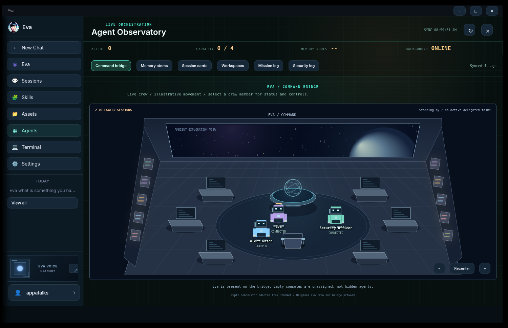
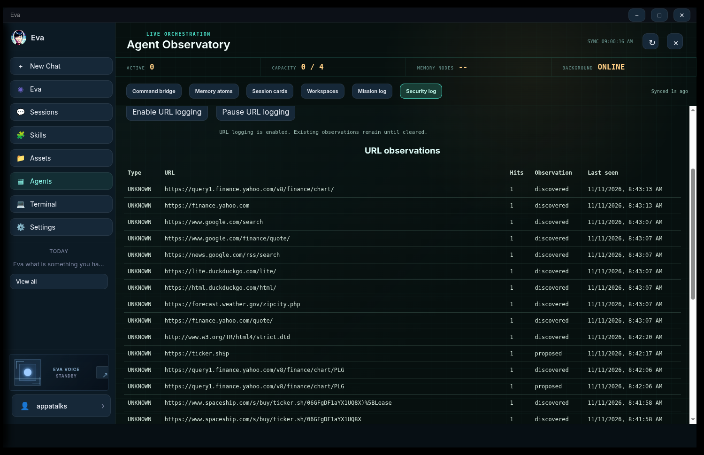
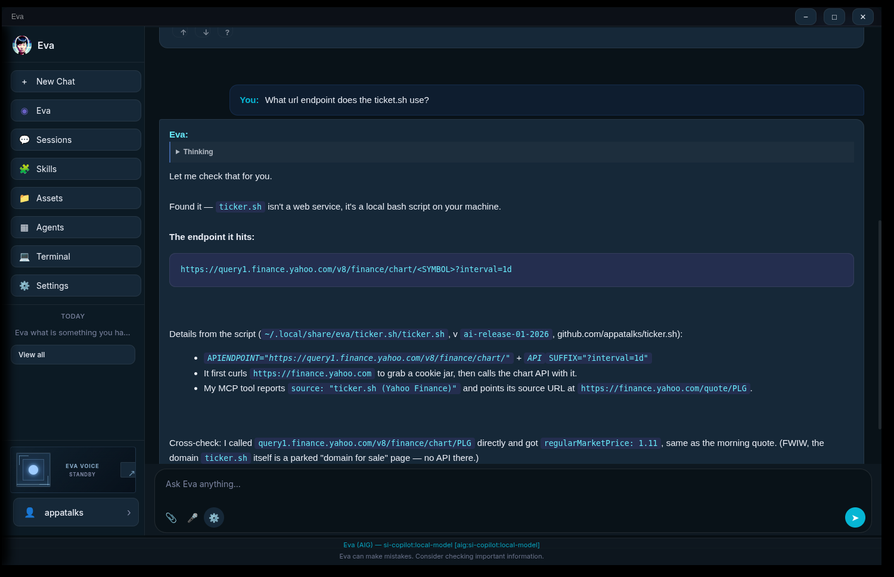

# Eva AI Assistant

**A local-first desktop AI assistant for conversation, memory, voice, automation, and software work.**

[Website](https://appatalks.github.io/eva-agent/) | [Technical documentation](README-2.md) | [Issues](https://github.com/appatalks/eva-agent/issues) | [MIT License](LICENSE)

## Preview

<table>
  <tr>
    <td colspan="2"><strong>Command bridge</strong><br></td>
  </tr>
</table>

<details>
<summary>More screenshots</summary>

<table>
  <tr>
    <td width="50%"><strong>Agent Observatory</strong><br></td>
    <td width="50%"><strong>Eva chat</strong><br></td>
  </tr>
  <tr>
    <td width="50%"></td>
    <td width="50%"></td>
  </tr>
  <tr>
    <td width="50%"></td>
    <td width="50%"></td>
  </tr>
  <tr>
    <td width="50%"></td>
    <td width="50%"></td>
  </tr>
</table>

</details>

## Overview

Eva brings cloud and local models into one focused desktop experience while keeping
configuration, approvals, and personal data under your control.

- **Unified model routing:** use GitHub Copilot ACP, OpenAI, OpenAI-compatible
  endpoints, or local models through LM Studio.
- **Durable local memory:** retain explicit facts with provenance, corrections,
  lifecycle controls, and an interactive memory view.
- **Agent Observatory:** inspect active agents, coding workspaces, mission history,
  security events, and memory from a visual command bridge.
- **Tools and automation:** run approved skills, research, scheduled work, terminal
  tasks, and MCP integrations with visible outcomes.
- **Voice and messaging:** use local speech features and optional Signal integration.
- **Workspace control:** create or import projects, monitor coding agents, and manage
  independent terminal sessions from the desktop app.

## Quick Start

```bash
curl -fsSL https://appatalks.github.io/eva-agent/get-eva.sh | bash
eva
```

Eva is added to the system application menu. Select **Eva (AIG)** on first launch for
the integrated routing, memory, and tools experience.

For source builds and platform requirements, see the
[technical documentation](README-2.md#setup-and-operation).

Current development version: **5.7.3** (unreleased)

Latest published standalone release: **5.6.10**

## Trust and Control

Eva stores chat state, memory, and runtime data locally by default. Cloud providers,
network tools, and autonomous coding features are used only when configured or
enabled. Consequential actions remain subject to authorization and confirmation
boundaries, and action receipts distinguish accepted work from verified completion.

Autonomous tools can access user-authorized workspaces or network resources. Review
the [runtime behavior and trust boundaries](README-2.md#runtime-behavior-and-trust-boundaries)
before enabling them.

## Documentation

- [Technical documentation](README-2.md) covers setup, providers, memory, voice,
  tools, architecture, and security boundaries.
- [Standalone guide](standalone/README.md) covers installation, packaging, updates,
  and runtime compatibility.
- [Development guide](docs/ai-development-guide.md) covers project structure,
  contribution workflow, and validation.
- [Testing contracts](docs/testing-contracts.md) defines behavior, security, and
  compatibility expectations.