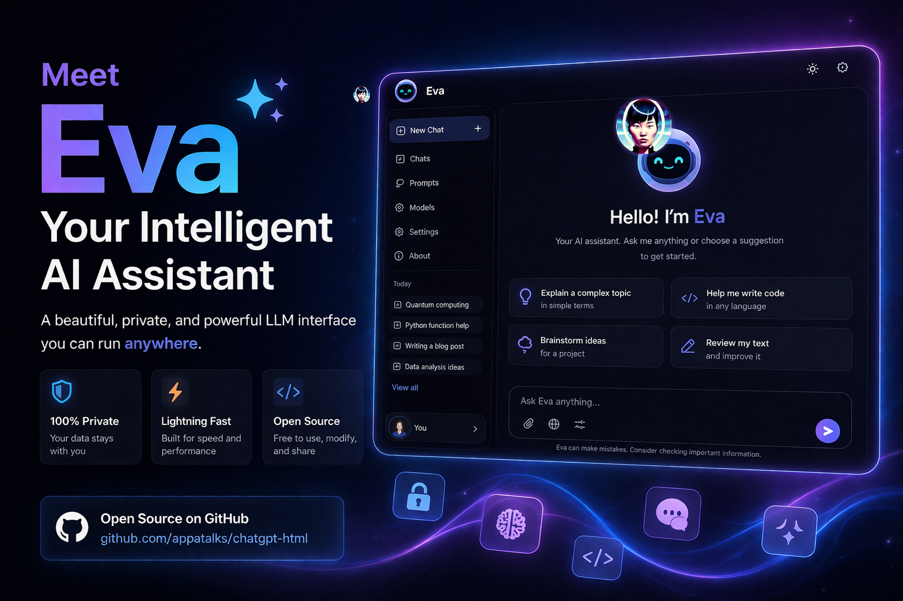
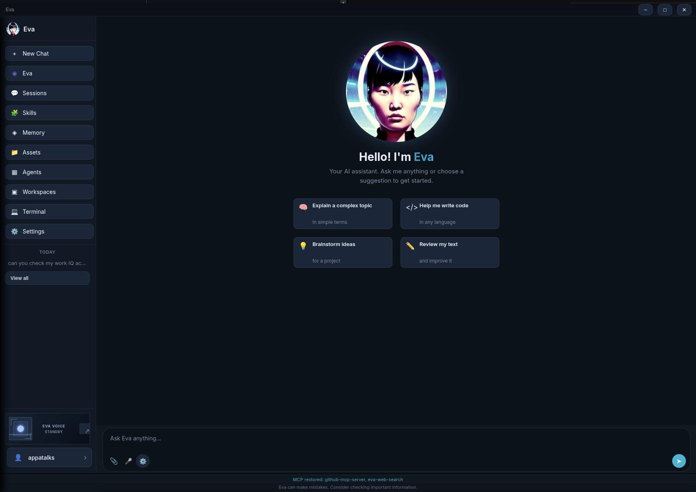
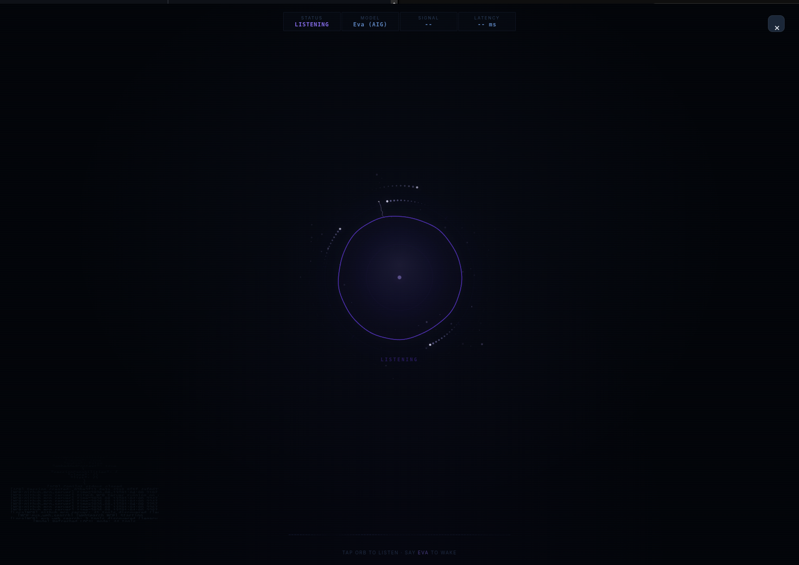
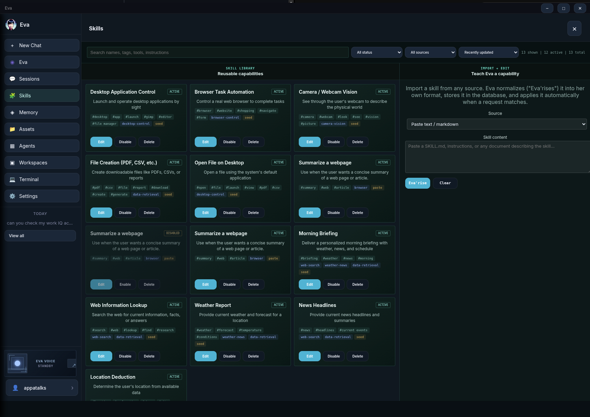
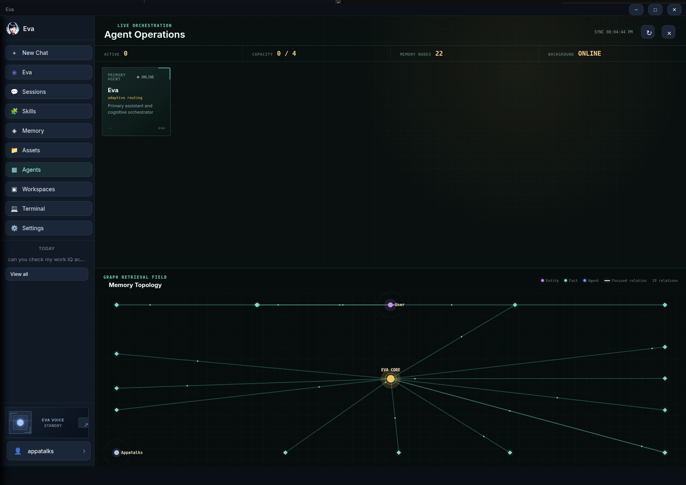
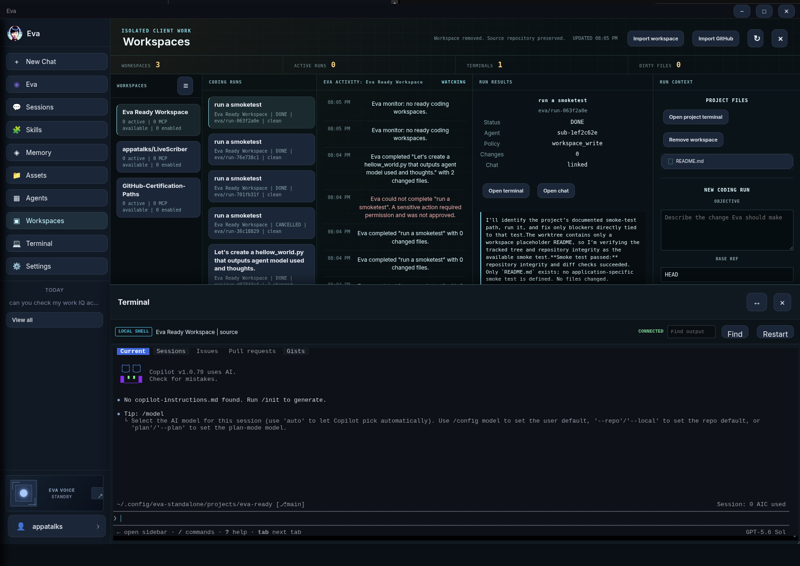
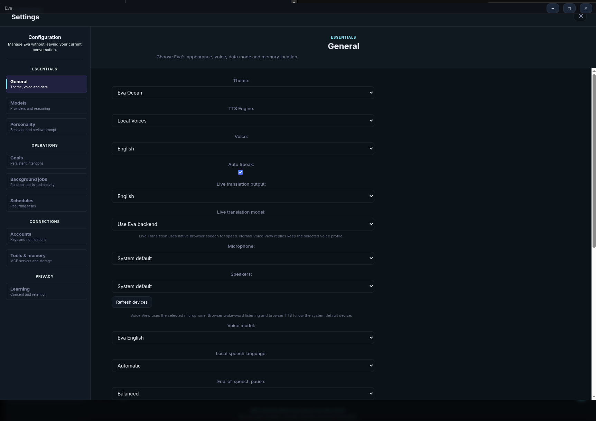

# Eva AI Assistant

[Website](https://appatalks.github.io/eva-agent/) | [Documentation](README-2.md) | [Issues](https://github.com/appatalks/eva-agent/issues) | License: MIT

Eva is a local-first AI assistant for conversation, durable memory, voice, automation,
and software work. It brings cloud and local models into one focused desktop experience
while keeping configuration, approvals, and personal data under your control.



## Highlights

- **One intelligent gateway:** route work across OpenAI, GitHub Copilot ACP, the
  SI Harness for OpenAI-compatible endpoints, and MCP tools without changing the
  conversation model.
- **Operations visibility:** background jobs are grouped by purpose, activity
  can be filtered, job settings persist across restarts, and scheduled-task
  attempts show their outcome.
- **Opt-in goal work:** a local model can prepare files in isolated Eva Ready
  worktrees, one round at a time, with randomized delays between rounds.
- **Flexible SI Harness runtime:** keep the backward-compatible Eva Direct path,
  or run the same SI endpoint/model through an isolated Copilot CLI ACP session
  for unified tool-capable chat. SI-Copilot fails explicitly when its endpoint or
  model is unavailable and never silently falls back to cloud Copilot. This first
  slice covers chat only; Adaptive Review is bypassed for SI-Copilot chat, and
  workspace and vision retain their existing runtime paths.
- **Durable, inspectable memory:** retain explicit facts locally with provenance
	linked to source conversation turns, editable explanatory context, lifecycle
	controls, corrections, bounded
	last-session recall, and interactive review through Agent Operations'
	Memory Topology workspace.
- **Grounded self-assessment:** distinguish unverified, contextual mentions from
  confirmed facts, and describe feedback, scheduling, and privacy boundaries
  without mistaking activity counters for evidence of answer quality. Runtime
  identity separates SI endpoint model aliases from internal compatibility keys
  and the Direct or Copilot execution path.
- **Intent-bound native actions:** conversational playlist requests use approved
  Skills; retries, repository follow-ups, and implicit PR targets stay bound to
  the preceding request. Structured action receipts distinguish browser handoffs
  from verified completion, survive in chat context without duplication, and
  report malformed or excess actions. Visual-agent availability checks local
  prerequisites rather than assuming readiness.
  Public-news follow-ups retain the recent user-specified topic through
  confirmations and status checks, and run native retrieval before answering
  rather than relying on a model's promise to search.
  Delegated shell tasks use task-scoped planning: ordinary approved commands
  can submit automatically, high-risk commands require confirmation, and model
  command payloads are never executed blindly.
- **Visible responder activity and benchmarking:** Eva's bridge avatar reflects
  actual pending chat requests. Explicit local tokens/s benchmarks use a bounded
  provider call and reported token usage, not shell scripts or word-count guesses.
- **Model-independent stock checks:** single/pair quote requests and scheduled
  market snapshots use verified native quote receipts, not model-written tool
  calls or GitHub/Copilot authentication. Unavailable symbols are explicit.
- **Agent Observatory:** an animated starship command bridge, in-place agent
  inspector, and preserved memory-atom view. A shared depth-sorted canvas scene
  places walking crew, consoles, shadows, and lighting in one room rather than
  separate tiles. The compositor adapts MIT-licensed StarNet code with retained
  attribution; all crew and bridge artwork is original Eva artwork. Movement is
  illustrative; only fresh reported running sessions perform working gestures.
  Stale snapshots pause agent activity and controls. Conversational delegation
  also launches real discussion batches from SI Copilot direct chat while
  preserving its configured endpoint. Inspect dependencies, open linked chats,
  and steer or interrupt supported agents without leaving the bridge.
  Subtle, transient crew bubbles show reported activity, streamed public output,
  and recorded upstream-output handoffs (at most two at once), never private
  reasoning or invented conversations.
  Workspaces now lives in its own Observatory tab with the same coding controls.
  A local Mission log checklist preserves final debriefs across restarts before
  eligible finished crew are dismissed; active dependencies and a one-minute
  reuse window are protected.
- **Signal account linking:** Settings > Accounts provides a Link Signal button,
  an in-panel QR code, completion status, cancellation, and fresh codes after
  expiry. Existing recipients and prior local account files are preserved.
- **Workspace control room:** monitor independent terminals and coding agents for
  the selected workspace, focus a tile, interrupt work, or send new direction.
  Project files stay beside Live and Details tabs. Create local Git workspaces
  or import existing projects through a responsive in-app folder browser.
- **Local-first operation:** use SQLite and local models by default, with cloud services
  enabled only when configured.

## Quick Start

```bash
curl -fsSL https://appatalks.github.io/eva-agent/get-eva.sh | bash
eva
```

Eva is also added to the system application menu. On first launch, select **Eva (AIG)**
for the integrated routing, memory, and tool experience.

Current development version: **5.7.2** (`Eva Standalone-5.7.2.AppImage`, unreleased).
Latest published standalone release: `Eva Standalone-5.6.10.AppImage`.

## Preview

<table>
	<tr>
		<td width="50%"></td>
		<td width="50%"></td>
	</tr>
	<tr>
		<td width="50%"></td>
		<td width="50%"></td>
	</tr>
	<tr>
		<td width="50%"></td>
		<td width="50%"></td>
	</tr>
</table>

## Trust by Design

- Explicit user facts are committed before Eva acknowledges saving them; ordinary
  questions do not become memory writes.
- Consequential actions remain behind confirmation and authorization boundaries.
- Live answers use source receipts and fail visibly when current data is unavailable.
- Model-supplied image HTML is sanitized; application-generated images retain
  their normal rendering without additional permission prompts.
- Secrets, runtime state, and personal memory stay outside the repository and release
  artifacts.

## Documentation

- **Suggested reading:** [Eva Whitepaper (PDF)](docs/Eva-Whitepaper.pdf) — design inspiration, architecture, trust boundaries, technical analysis, and future direction.
- [Technical documentation](README-2.md): setup, providers, memory, voice, MCP, workspaces, architecture, and roadmap
- [standalone/README.md](standalone/README.md): AppImage build and runtime
- [docs/ai-development-guide.md](docs/ai-development-guide.md): focused development workflow, ownership map, and validation bundles
- [docs/testing-contracts.md](docs/testing-contracts.md): behavior, security, and compatibility test policy for refactors
- [docs/eva_default_skills/README.md](docs/eva_default_skills/README.md): canonical default Skills catalog and category taxonomy
- [Website](https://appatalks.github.io/eva-agent/): features, comparison, and install guide
